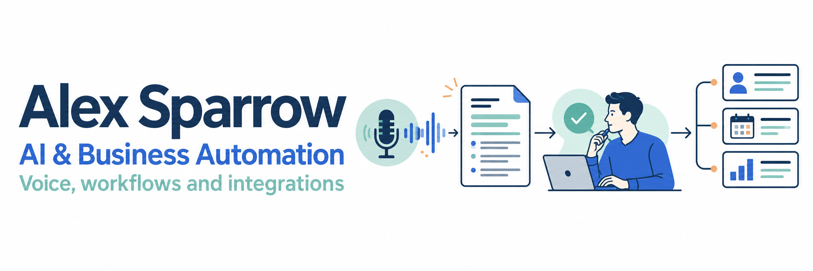
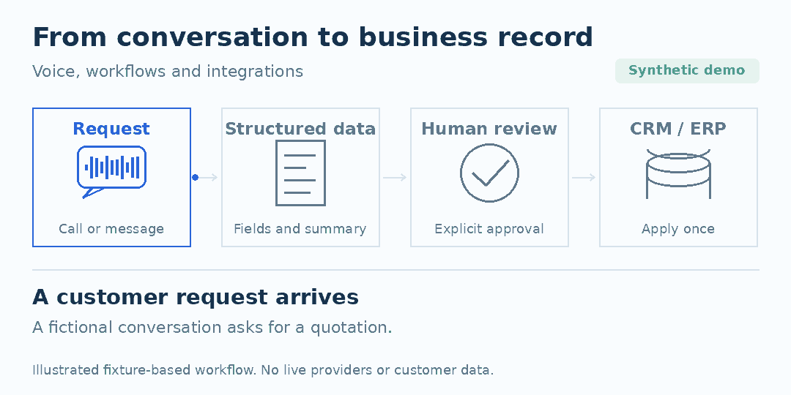

# Alex Sparrow · AI & Business Automation



[](https://github.com/bolesusi147-web/ai-automation-portfolio/actions/workflows/checks.yml)

**Practical AI implementation, voice workflows and reliable business integrations.**

I combine over 10 years of management experience in electronic components
distribution with AI-assisted implementation across CRM/ERP, call transcription
and conversational voice agents. My work connects business requirements,
integration, validation, troubleshooting and ongoing support.

This portfolio contains **independent, runnable demonstrations** of those patterns.
All inputs are synthetic. It does not expose customer information or private
business systems. Code here was prepared with AI assistance and reviewed/tested;
it is a demonstration of implementation judgement, not a claim of a conventional
senior software-engineering career.

**Hiring for AI implementation, automation or integrations?**
Start with the [two-minute portfolio review](docs/hiring-guide.md).

## See the workflow



**A request becomes a reviewed, traceable business record.** The 13-second
illustration connects the portfolio's workflow patterns: conversation data,
structured output, explicit approval and duplicate-safe updates.
It is a storyboard of synthetic demonstrations, not a recording of a live
product or an existing review interface.

[View the static diagram](assets/workflow.png) ·
[Inspect the actual demo outcomes](examples/crm-events.json)

## Where this experience fits

| Role or team | Relevant experience | Start here |
|---|---|---|
| AI implementation and automation | Translate business needs into n8n/API workflows, validate outputs and investigate failures | [Business integrations](docs/project-cases.md#business-workflows-and-crmerp-integration) |
| Voice and conversation systems | Telephony transport, transcription, speaker roles, interruption and fallback | [Voice and transcription](docs/hiring-guide.md#voice-and-conversation-systems) |
| Solutions and integration consulting | Connect CRM/ERP processes with technical requirements, review and operational ownership | [Architecture](docs/architecture.md) |
| Business operations and electronic components | Over 10 years of management, procurement and logistics, combined with applied AI work | [Background](#background) |

## Run in two minutes

Python **3.11+**, standard library only. No accounts, API keys or paid services.

```bash
git clone https://github.com/bolesusi147-web/ai-automation-portfolio.git
cd ai-automation-portfolio
python3 -m portfolio demo
python3 -m unittest discover -s tests -v
python3 tools/check_public_content.py
```

The demo creates `.demo-output/`: a JSON report, readable transcript, voice event
trace, CRM audit database and synthetic stereo test tones. Existing output is
never overwritten; use `--output .demo-output/another-run` for another run.
**The tones are transport-test signals, not generated speech.** Transcripts and
model responses are fixtures, not output from a live STT or LLM API.

## Three demonstrations

| Demonstration | What to review | Business relevance |
|---|---|---|
| [Voice agent transport](portfolio/voice.py) | TCP fragmentation, bounded PCM frames, interruption, timeout/fallback, read-only tool calling | Connect telephony to an assistant while controlling stale playback and failure paths |
| [Call-to-dialogue processing](portfolio/transcript.py) | Stereo separation, timestamps, explicit speaker mapping, weaker overlapping echo suppression | Turn a conversation into a usable, attributable record |
| [AI output → CRM](portfolio/operations.py) | Strict schema, human approval, low-confidence review, SQLite transactions, retry/idempotency audit | Keep model mistakes and duplicate deliveries from changing business state |

```text
Synthetic event or call
  → Normalise input
  → Fixture provider response
  → Validate output
  → Check human approval and confidence
      ├─ Review required → Audit and review queue
      └─ Approved       → Transactional CRM update → Idempotency record
```

The offline run demonstrates four CRM outcomes:

```text
review → applied → duplicate → review
```

The customer is changed once. Replaying the approved event is a no-op;
malformed output is audited for review. [See the saved example report](examples/report.json).

## Integration materials

- [Project case notes: contribution, scope and evidence](docs/project-cases.md)
- [Architecture and failure boundaries](docs/architecture.md)
- [Recruiter guide: experience, evidence and suggested review paths](docs/hiring-guide.md)
- [Importable n8n validation reference](n8n/crm-review-workflow.json)
- [Synthetic example transcript](examples/transcript.txt)
- [Privacy model and publication checks](docs/privacy.md)
- [Visuals: storyboard, provenance and rebuilding](docs/visuals.md)

The n8n reference demonstrates validation and review routing; persistence and
idempotency are implemented in the Python demonstration. Live provider adapters,
SIP registration, production identity/access controls and a review UI are outside
this repository's scope. These demos do not measure recognition quality, business
ROI or real-call latency.

## Background

- Over 10 years of management experience, including procurement and logistics;
  P&L responsibility for a distributor with annual turnover exceeding $20M.
- Practical n8n/API, PostgreSQL/Supabase, Codex/Claude Code and VS Code workflows.
- Project experience with Asterisk/SIP/AudioSocket, real-time speech APIs,
  transcription, tool calling and Obsidian/RAG workflows.
- MIET Specialist Diploma, five-year programme in Economics and Marketing;
  postgraduate international study in Marbella, Spain.
- English: fluent business/technical communication. Russian: native.
  Spanish: reading and correspondence; limited conversational proficiency.

**Location:** CIS region. **Contact:** bolesusi147@gmail.com.
