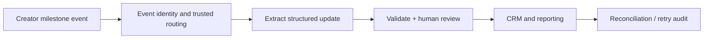

# For ElevenLabs and AI automation teams

## Why this portfolio is relevant

My strongest fit is the intersection of operational ownership and practical AI
implementation: understanding a business process, connecting its tools, checking
outputs and maintaining the resulting workflow.

| Automation need | Evidence to inspect |
|---|---|
| Connect operational systems through APIs and n8n | Importable n8n validation workflow; Python CRM event pipeline |
| Keep CRM updates accurate and traceable | Validation, human approval, transaction and idempotency tests |
| Handle conversations and voice-related data | Timestamped call reconstruction; AudioSocket and interruption tests |
| Turn a business requirement into an owned workflow | End-to-end offline CLI, audit artefacts, explicit failure boundaries |
| Troubleshoot and explain limitations | Architecture notes, failure-case tests, reproducible example output |

## Transfer example: creator operations

My source-domain experience is B2B electronic components, not previous influencer
operations. A similar workflow could connect creator onboarding, an approved
agreement, campaign milestones and CRM/reporting:

The code demonstrates the control patterns for this transfer. It does not claim
an implemented creator-payment system, influencer platform integration or prior
ElevenLabs API integration. Financial actions would require additional approval,
reconciliation and access controls.

## Suggested review path

1. Run `python3 -m portfolio demo` and inspect the four CRM outcomes.
2. Read `portfolio/operations.py` and the failure tests in `tests/test_operations.py`.
3. Inspect `voice-trace.json` for interruption and provider-fallback behaviour.
4. Review the n8n reference and discuss the actual systems and constraints of the role.

I can discuss anonymised project decisions, trade-offs and implementation review.
Private business code and real customer recordings are intentionally not public.
